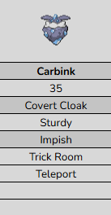
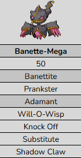
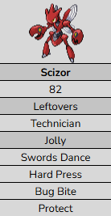
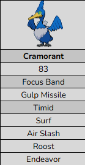
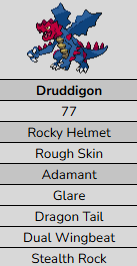
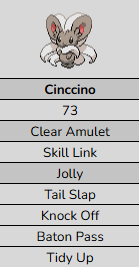

# Support Pokémon

A Pokémon is classified as **Support** by the AI if it satisfies the following conditions:

* The Pokémon has **at most one damaging move**.  
* The Pokémon has **no moves with base power > 75**.  
* Pokémon with Imposter are excluded.

These moves are treated as utility and do **not** contribute toward the damaging move count:

* Fake Out, Feint, Upper Hand  
* Endeavor, Super Fang  
* Dragon Tail, Circle Throw  
* Knock Off  
* Foul Play  
* Future Sight  
* Bug Bite  
* Pollen Puff  
* Speed control (e.g. Rock Tomb, Glaciate)  
* Surf and Dive (only when the user is a Cramorant)

The support class plays a notable role in some [Switch AI](switch-ai.md) decisions.

## Example Support Pokémon

{ width="135" }
{ width="135" }
{ width="135" }
{ width="135" }
{ width="135" }
{ width="135" }